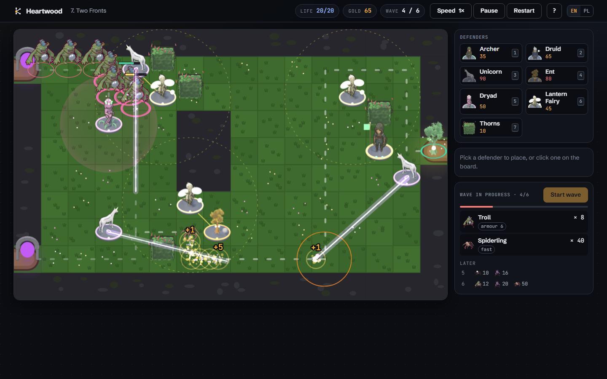
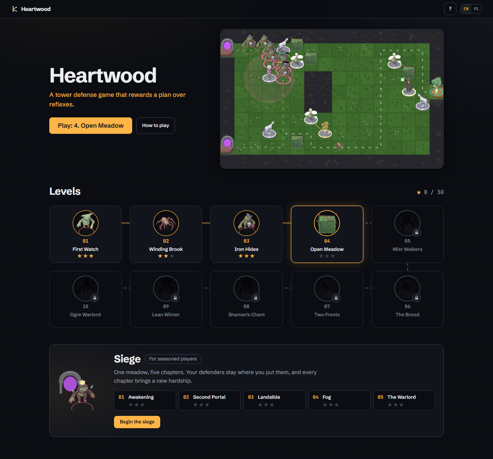
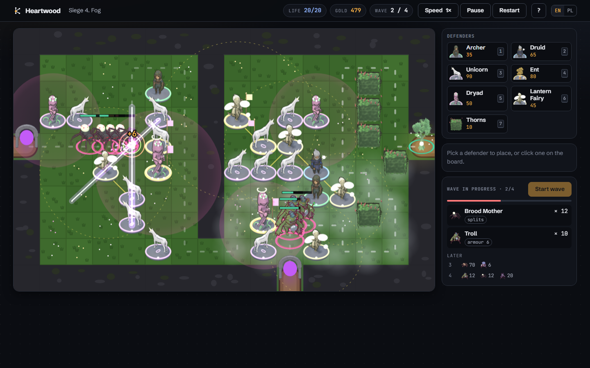
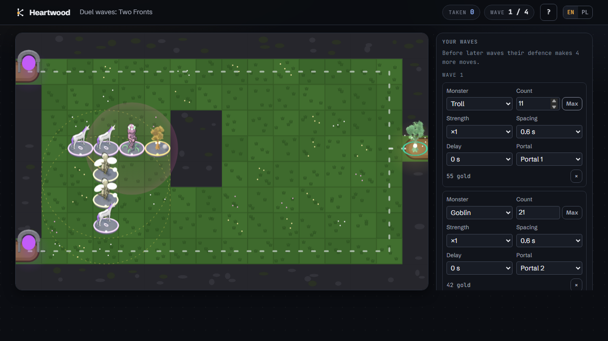
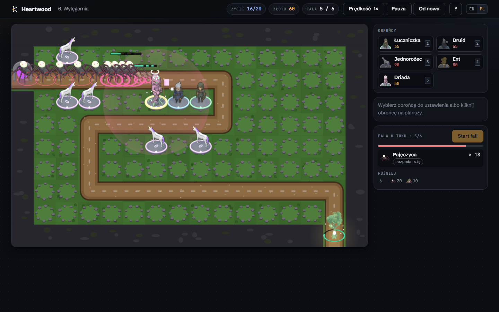

# Heartwood

A tower defense game that rewards a plan over reflexes. Monsters pour out of the portals towards
the Heart Tree; you place defenders (archers, druids, unicorns, ents, dryads, lantern fairies and
thorn hedges), read every wave before it starts and pick the right answer to each threat. Ten
levels, each built around one idea, a five-chapter Siege on one map where the defence carries
over and every chapter adds a hardship, and a duel for two players played through links. Every
level, every chapter and every duel map is proven in CI.



Play it on [kokot.it](https://kokot.it/en/projects/relay-defense/). The interface is in English and
Polish. The repository keeps its first name, relay-defense; inside the code the defenders and
monsters still go by their engine names (agents and faults, listed below; the Heart Tree is the
core, portals are gates, gold is credits, stone circles are sockets and paths are lanes).

## What makes it a logic game

- **Nothing is hidden.** The whole wave list is on screen before the first wave, the simulation is
  deterministic, and the game waits between waves. A level is lost by a bad plan, not a slow
  click.
- **Every monster asks a question.** Armour cuts every hit by a flat amount, so many small hits do
  almost nothing. Invisible Wraiths cannot be hit without a Lantern Fairy. A Brood Mother bursts
  into a swarm of Spiderlings. Shamans heal whatever is near them. The Ogre Warlord shields his
  escort and shrugs off slows.
- **Geometry matters.** The Unicorn's beam pierces everything on a line, so it belongs at the end
  of a straight path. The Ent's boulder has a dead zone and leads its target, so it pairs with a
  Dryad. The Lantern Fairy strengthens the eight tiles around her, and that adds up. On the meadow
  every defender is part of the maze, and the preview shows the new route before you commit.
- **Undo is free.** Selling in the same build phase refunds everything, so a layout can be tried
  and taken back. The maze on the meadow only changes between waves (stone circles stay open), so
  monsters cannot be juggled back and forth by opening and closing a gap.

| Defender      | Code name | Role                                                                   |
| ------------- | --------- | ---------------------------------------------------------------------- |
| Archer        | pulse     | cheap single-target arrows, useless against armour                     |
| Druid         | arc       | chain lightning across monsters walking close together                 |
| Unicorn       | lance     | a beam through every monster on its line, ignores armour               |
| Ent           | mortar    | leading area boulder, cannot hit close by                              |
| Dryad         | throttle  | slow field of roots; two fields do not stack                           |
| Lantern Fairy | beacon    | reveals invisible monsters, strengthens neighbouring defenders; stacks |
| Thorns        | wall      | a cheap hedge for building mazes on the meadow                         |

| Monster      | Code name | Trait                                      |
| ------------ | --------- | ------------------------------------------ |
| Goblin       | spark     | plain                                      |
| Spiderling   | mite      | tiny, fast, in swarms                      |
| Troll        | bulwark   | armour                                     |
| Wraith       | phantom   | invisible until revealed                   |
| Brood Mother | splitter  | bursts into three Spiderlings              |
| Shaman       | mender    | heals the monsters around him              |
| Ogre Warlord | colossus  | boss: heavy armour, resists slows, shields |

Each defender except Thorns has three levels (a gold ring and a banner at level 2, a halo at
level 3) and four targeting modes (first, last, strongest, weakest).

## Levels and progress

The menu is the game's landing page: a live board from Two Fronts next to one button that opens
the next level to win, the ten levels as a path of nodes, and the Siege under it. The first three
levels are open; winning a level opens the next one, and a locked node shows the silhouette of the
monster or defender waiting there. The Siege is open from the start.

- **Nothing new in the save.** Only wins are saved, so a level is open when it or the one before
  it has a result. Players who won levels before the path existed find them open.
- **Nobody is locked out.** `?level=<id>` still opens any level, a locked node offers to open them
  all, and the help (?) has the same switch (kept in the browser under its own key).
- Level descriptions live in the briefing before each level, the introduction and the star rule in
  the help, so the menu itself is pictures, names and stars.



## Siege

A separate mode next to the ten levels: one meadow split by a ridge, five chapters of four waves.
The defenders, their upgrades and the gold carry over from chapter to chapter, and each chapter
adds a hardship:

| Chapter       | What changes                                                               |
| ------------- | -------------------------------------------------------------------------- |
| Awakening     | one portal; the pass through the ridge is cracked, a second portal sleeps  |
| Second Portal | the portal on the southern edge wakes                                      |
| Landslide     | the pass collapses into rock and the western route goes round to the south |
| Fog           | fog over the south-east: defenders standing in it keep 70% of their range  |
| The Warlord   | the Ogre Warlord comes, and every monster gains 2 armour                   |

- **Nothing is hidden here either.** The sleeping portal and the cracked pass are on the board
  from the first chapter, the fog still to come is a faint haze on the board, the first briefing
  lists every hardship of the siege, and the placement rule
  already counts them: a maze may not seal the sleeping portal in, nor depend on the pass.
- **A defeat restarts the chapter** from its checkpoint: the gold and defenders it began with.
- **Every checkpoint can be won.** Before the first wave of a chapter, every defender brought into
  it sells back at full value, and when the gold and the defenders together are worth less than
  the chapter's floor, the Heart Tree tops the gold up to it. A player can always sell everything
  and rebuild the floor solution, so proving each chapter from an empty board and its floor gold
  proves every checkpoint.
- Progress (stars per chapter and the checkpoint) is kept in the browser under its own key, with
  the campaign's version: a checkpoint from an older balance is dropped, the stars stay.



## Duel

A mode for two players, with no account and no server: the whole duel travels in three links.

1. The challenger picks a map (the Siege meadow with both portals open, Two Fronts or Colossus)
   and plays a sparring run against fixed waves shown in advance. Every move made before a wave
   is written down: that is their defence. The game gives a link to send.
2. The rival opens it, sees the defence on the board and composes four waves against it from 560
   gold, watching them attack as often as they like. Then they build their own defence in a
   sparring run and send a link back.
3. The challenger composes waves against the rival's defence and sends the last link. Both see the
   result: each side's waves against the other side's defence, played to the end. Whoever takes
   more lives from the other Heart Tree wins; an equal count is a draw. Either bout can be
   watched again.

- **Prices.** Both sides get 560 gold. A monster costs half of what killing it pays (a Brood
  Mother counts her Spiderlings), times its strength (×1 to ×4); a group's cost is rounded up. A
  wave has one to four groups of up to 500 monsters.
- **Why both play both sides.** Measured before the mode was built: whoever moves second and sees
  the other's plan always wins, at any price of monsters. With each player attacking the other's
  defence that advantage cancels out, and nothing has to be hidden. Lives are counted without a
  limit, so the score tells a weak defence from a good one instead of ending 20 to 20.
- **A defence is a script.** It replays exactly against other waves; a move the gold no longer
  covers is skipped and counted. In a sparring run moves wait for the build phase, because a
  replay applies them only between waves.
- **The same game in every browser.** The result is computed in each player's browser, so the
  simulation avoids maths that JavaScript engines may round differently, and CI replays every
  reference solution in Node, WebKit and Firefox.
- **Proven in CI.** Each duel map carries a reference defence (the solver against the sparring
  waves, won without a loss) and an attack composed against it that still takes lives
  (`tests/duel.test.ts`, `tests/duel-solutions.ts`).
- **Links.** The duel is in the hash (`#duel=`), so it never reaches a server. It is versioned:
  a link made with an older balance says so instead of showing a different result.



## How the levels are balanced

Balancing a puzzle by hand is guesswork, so the repository carries its own tools:

- **A look-ahead solver** (`npm run solve -- <level>`). In each build phase it tries every
  affordable action (an agent on a tile near the route, an upgrade), simulates the coming waves
  on a copy of the game, keeps the best action and repeats. It writes its plan as TypeScript.
- **Reference solutions** (`tests/solutions.ts`), produced by the solver. The test suite replays
  each one and expects a win, so every level is winnable at its shipped difficulty.
- **A difficulty probe** (`npm run probe`). A careless player spends all its credits on random
  agents near the route and upgrades at random. From the third level on it wins at most 15% of
  the time (a test holds that line); in 300 runs per level it
  wins 3% of the third level and at most 1% of any later one.
- **The Siege proofs** (`tests/siege-solutions.ts`): one solver solution per chapter from its
  floor (`npm run solve -- siege-<n>`), and one run of the whole campaign that carries its
  defence from chapter to chapter (`npm run solve -- siege`). The careless player gets at most
  15% of any chapter from its floor, too.
- **A tuning table** (`npm run tune -- <level>`): solver result and careless win rate across a
  range of enemy strength. Each level ships at 50–90% of the strength the solver can still beat,
  lower for the tutorial levels and closer to the edge for the last ones.



## Architecture

```
src/engine/   pure TypeScript simulation, no DOM: map and flow-field routing, placement rules,
              agents, faults, shots, waves, economy; fixed 30 Hz tick; clone() for look-ahead
src/levels/   the ten levels: ASCII maps, credits, waves, available agents, difficulty; the
              Siege campaign (siege.ts), turned into one ordinary level per chapter
src/render/   2D canvas renderer: cached background layer, interpolated movement, effects,
              particles; vector sprites shared with the UI icons; colours from the brand tokens
src/ui/       menu, briefings, play screen, results, help; input (mouse, touch, keyboard);
              i18n (EN/PL); progress in localStorage; embed mode
art/          CC0 source models, Blender scripts and the sprite manifest (art/README.md)
scripts/      solver, probe, tuning, replay printer, screenshots, smoke test, guards
tests/        engine mechanics, levels (solutions win, careless play loses), i18n, progress,
              language guard
```

- **Routing.** A breadth-first flow field from the core over walkable tiles. Faults follow it
  tile by tile and prefer to keep their heading, so routes stay straight. A placement is refused
  when it would cut any gate, or any fault already on the board, off from the core.
- **Determinism.** No randomness in the simulation, fixed iteration order, fixed tick. The same
  actions always give the same result, which is what makes replays, the solver and the tests
  possible. Randomness lives only in the renderer's particles. The simulation also avoids the
  maths each JavaScript engine may round its own way (`Math.hypot`, trigonometry, `**`), so the
  same holds in every browser: CI replays every reference solution in Node, WebKit and Firefox
  and compares every simulated number after every tick (`npm run determinism`).
- **Smooth at any refresh rate.** The board remembers positions before each tick and
  interpolates between ticks; effects age in game time, so they keep pace with the speed setting
  and freeze on pause.

## Accessibility

Keyboard play end to end: `1`–`7` pick a defender, arrow keys move a board cursor with spoken cell
descriptions, `Enter` builds or selects, `Space` starts a wave or pauses, `U`/`S`/`T` upgrade,
sell and change the target, `F` changes speed, `Esc` cancels. Game events are announced in a
live region, dialogs keep focus and make the page behind them inert, and `prefers-reduced-motion` stops screen shake, idle animation
and most particles; the board on the menu then holds still. Locked levels stay focusable and
are announced as locked; activating one says which win opens it. On touch screens the first tap
previews a placement and the second builds.

## Embedding

`?embed=1&lang=<en|pl>` lays the game out for an iframe: the height follows the width only, and
the page posts `{ type: 'relay-defense:height', height }` to its parent whenever it changes.
`?level=<id>` opens a level directly, `?mode=siege` the Siege at its checkpoint and `?mode=duel` a new
duel; a duel link carries its state in the hash (`#duel=`). This is how [kokot.it](https://kokot.it) embeds it.

## Stack

TypeScript (strict), Vite, Canvas 2D, Vitest, Playwright (smoke test and screenshots), ESLint,
Prettier. No framework and no runtime dependencies.

## Scripts

| Script                   | What it does                                                            |
| ------------------------ | ----------------------------------------------------------------------- |
| `npm run dev`            | dev server                                                              |
| `npm run build`          | typecheck and production build to `dist/`                               |
| `npm test`               | unit and level tests                                                    |
| `npm run lint`           | ESLint and Prettier check                                               |
| `npm run smoke`          | plays the build in Chromium and checks the embed height (after build)   |
| `npm run determinism`    | replays every reference solution in Node, WebKit and Firefox: same game |
| `npm run solve -- <id>`  | look-ahead solver, prints a solution (`siege-<n>`, `siege` for Siege)   |
| `npm run sim -- <id>`    | replays the reference solution and prints the board                     |
| `npm run probe`          | careless-player win rate per level                                      |
| `npm run tune -- <id>`   | solver and probe across enemy strength                                  |
| `npm run sprites`        | renders the character sprites with Blender (art/README.md)              |
| `npm run screenshots`    | README screenshots (needs `npm run dev -- --port 5391`)                 |
| `npm run check:language` | English everywhere except the Polish UI dictionary                      |
| `npm run check:wording`  | wording guard for the build and the docs                                |

Polish text lives only in the Polish block of `src/ui/i18n.ts`; the language guard fails on it
anywhere else.

## Art

The characters are free 3D models (CC0, public domain) given props and rendered to sprites in
Blender by `npm run sprites`; the PNGs are committed. How it works and the full list of files:
[art/README.md](art/README.md).

| Role                        | Model                                         | Author     | Source                                                           |
| --------------------------- | --------------------------------------------- | ---------- | ---------------------------------------------------------------- |
| archer, druid, dryad, fairy | RPG Characters: Ranger, Wizard, Rogue, Cleric | Quaternius | https://opengameart.org/content/lowpoly-rpg-characters           |
| unicorn                     | White Horse                                   | Quaternius | https://poly.pizza/m/bEdE4rmZy9                                  |
| troll                       | Orc                                           | Quaternius | https://poly.pizza/m/5vO2YJsPEf                                  |
| spiderling, brood mother    | Spider                                        | Quaternius | https://poly.pizza/m/yRYJiAJyiM                                  |
| goblin                      | imp model (original title in art/README.md)   | Quaternius | https://poly.pizza/m/S7jYW6Amye                                  |
| wraith                      | Ghost                                         | Quaternius | https://poly.pizza/m/Iip30bDHmu                                  |
| shaman                      | Mushroom King                                 | Quaternius | https://poly.pizza/m/grnFTziU8u                                  |
| ogre warlord                | Yeti                                          | Quaternius | https://poly.pizza/m/ceRHrn8HHE                                  |
| ent, heart tree             | Tree (two variants)                           | Quaternius | https://poly.pizza/m/qZtx0AHhcy, https://poly.pizza/m/aVOxaHRPWe |
| thorns                      | Hedge                                         | Quaternius | https://poly.pizza/m/df8uCl1YpK                                  |
| portal                      | Arch Round                                    | Quaternius | https://poly.pizza/m/B9QABewqLv                                  |

All models are CC0 1.0. The props added in Blender and the rendered sprites are MIT, like the
code.

## Licence

MIT. The brand fonts (Schibsted Grotesk, JetBrains Mono) are under the SIL Open Font License;
the licences are next to the files in `src/assets/fonts/`.
